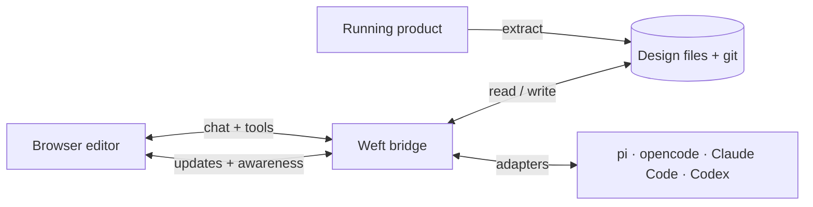

# Weft

> **Agent-native design canvas for the browser.**
>
> Design files that designers and coding agents shape together — in real time, in a format any harness can read and write.

Weft is a Figma alternative built for a world where humans and coding agents work on the same product. Today the design lives in an opaque cloud file and the implementation lives in a repository, and the agent can touch one but not the other. Weft closes that gap: a design file is a plain-text, versioned document in your repository, a browser canvas renders it live, and any coding agent — pi, opencode, Claude Code, Codex, or one you write tomorrow — can read it, edit it, and build from it.

## Why the name

In weaving, the **warp** is the structure held in tension and the **weft** is the thread carried across it. The design and the implementation are the two thread systems; the product is the cloth they make together. An agent is not a guest in the design file — it is one of the threads.

The name fits the family — Enclave, Nexus, Ratio, Tempo — and gives the architecture its own vocabulary without borrowing Figma's.

## What makes Weft different

- **Files, not silos.** A design is a directory of deterministic JSON and assets that lives beside the code. It diffs, reviews, branches, and merges like everything else in the repository.
- **Any agent, no plugin.** Agents get first-class access through files, a CLI, an MCP server, and a live bridge. Hosted assistants, local harnesses, and custom agents all use the same contract.
- **Browser-native.** No install to view or edit. Open a URL, join a file, and work; the rendering is the browser's own DOM, not a native runtime.
- **Real-time by default.** Presence, cursors, and concurrent edits are part of the document layer, not a paid add-on.
- **Extract the real product.** Capture a running page — markup, styles, and assets — into frames, annotate them, and let an agent turn the annotations into code changes.
- **Designs you can build from.** Tokens, layout, and content are structured data, so the same file can drive the canvas, an export, or an agent's implementation.

## How it works, at a glance



The **bridge** is a small local process. It serves the editor, owns file materialization, relays real-time updates, and translates between an agent session and the document. The **files** are the source of truth. The **editor** is one client of the document contract, not the contract itself.

## Principles

1. **The file is the product.** If a capability cannot be represented in the design file, it does not exist.
2. **No privileged agent.** Anything the built-in assistant can do, any external harness can do through the same documented tools.
3. **Local-first, cloud-optional.** The default path runs entirely on your machine; sync is a deployment choice.
4. **Fidelity over cleverness.** Extracted pages render as real DOM in a sandbox, not as screenshots, so what you review is what ships.
5. **Reversible everything.** Every agent edit is a document operation with an author, a timestamp, and an undo path.
6. **Lightweight by construction.** Plain text, browser APIs, a small dependency surface, and no native runtime.

## Status

Pre-alpha, headless-tooling phase. The founding decisions are recorded in [`docs/decisions/`](docs/decisions/); the working system design is in [`docs/architecture.md`](docs/architecture.md).

The core document model is implemented in [`@weft/core`](packages/core): the schema, pure node operations, a deterministic JSON writer, and a dependency-free validator. The filesystem layer and the `weft` CLI are implemented in [`@weft/design-io`](packages/design-io) and [`@weft/cli`](packages/cli). Together they are covered by 145 tests and a readable [starter design](examples/starter.weft/). The CLI can validate, format, inspect, read pages and nodes, and apply attributed commands with an inverse for undo. No editor is shipped yet.

The first milestone is deliberately small: open a file in the browser, edit it, have an external agent change it live, and extract one real page into it. See the [MVP exit criteria](docs/product.md#mvp-exit-criteria).

## Try it

```bash
pnpm install
pnpm build

# Inspect the read-only starter design.
pnpm weft validate examples/starter.weft
pnpm weft inspect examples/starter.weft --json
pnpm weft get examples/starter.weft --page Landing

# Create and validate a new design.
pnpm weft init /tmp/weft-demo --name "Demo"
pnpm weft validate /tmp/weft-demo
pnpm weft id --prefix nd
```

`weft fmt` rewrites the manifest and pages into canonical JSON; `--check` reports without writing. `weft apply` applies a JSON command and returns its inverse. See the [CLI guide](docs/cli.md).

## Repository layout

```text
weft/
├── apps/          # browser editor and other user-facing surfaces
├── packages/      # document model, renderer, CLI, bridge, MCP server
├── docs/          # product, architecture, decisions, and history
└── examples/      # sample design files and host integrations
```

The layout is the intended shape; packages are added as decisions land. Founding records: [ADR 0001](docs/decisions/0001-project-name.md) (the name), [ADR 0002](docs/decisions/0002-design-files-as-plain-text.md) (design files as plain text), [ADR 0003](docs/decisions/0003-document-schema-v1.md) (the schema), [ADR 0004](docs/decisions/0004-headless-cli-and-design-io.md) (headless-first tooling), and [ADR 0005](docs/decisions/0005-command-protocol.md) (the command protocol).

## Documentation

- [Product definition](docs/product.md) — who it is for, what it does, and how we know the first version is done.
- [Architecture](docs/architecture.md) — components, document model, agent surfaces, real-time layer, and risks.
- [CLI](docs/cli.md) — commands, JSON output, exit codes, and agent recipes.
- [Decision records](docs/decisions/README.md) — why the system is shaped this way.
- [Project history](docs/HISTORY.md) — the timeline that ties releases, stack changes, and ADRs together.
- [Changelog](CHANGELOG.md) — what shipped.

## License

MIT. See [LICENSE](LICENSE).
