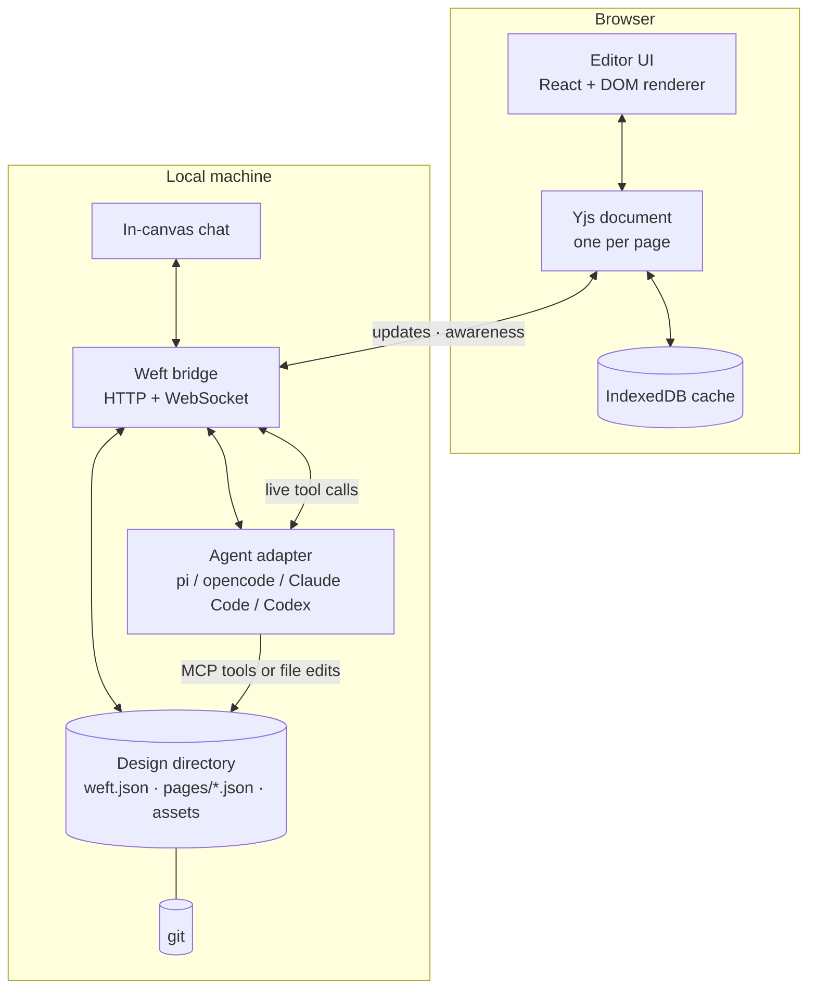

# Architecture

**Status:** Draft. The constraints, the plain-text decision (ADR 0002), the v1 document schema (ADR 0003), the headless CLI layer (ADR 0004), the command protocol (ADR 0005) and the published JSON Schema (ADR 0006) are agreed. The core, CLI and structural contract are implemented; choices marked *(proposed)* still need their own decision records, and nothing here overrides an accepted ADR.

## 1. Constraints

| Constraint | Consequence |
| --- | --- |
| Browser-native | The editor is a web app: no native install, no desktop shell, no embedded browser engine. |
| Agent-agnostic | The agent surface is a documented contract (files, MCP, live channel), not an integration with one vendor. |
| Local-first | The default deployment is a repository plus a local process; the network is optional. |
| Lightweight | Plain text, browser APIs, small dependencies, fast cold start. |
| Real-time | Concurrent editing, presence, and live agent edits are core, not an add-on. |
| Design → code | The document must carry enough structure (layout, tokens, content, assets) to implement from. |
| Fidelity | Captured product pages must render as they ship, not as a re-creation. |

## 2. System shape



### Components

- **`apps/web`** — the editor: canvas, layers, inspector, presence, chat. React + TypeScript *(proposed)*. Renders frames as DOM; uses canvas only for selection chrome and the minimap.
- **`packages/core`** — document schema, node operations, validation, migrations, deterministic serialization. No DOM, no network. Shared by the editor, bridge, CLI, MCP server, and exporter.
- **`packages/design-io`** — Node filesystem access for design directories: safe paths, atomic writes, read/inspect/validate, canonical formatting, init, summary. Keeps Node out of the browser core.
- **`packages/contract`** — the published JSON Schema and conformance fixtures for manifests, pages and commands. Structural validation only; the core remains authoritative for semantic checks.
- **`packages/render`** — document-to-DOM renderer and exporter. One renderer so the canvas and the export cannot disagree.
- **`packages/bridge`** — local daemon: serves the editor in development, persists Yjs state, materializes files, watches external writes, authenticates local clients, and proxies agent sessions.
- **`packages/cli`** — the headless `weft` client. Today: `init`, `validate`, `fmt`, `inspect`, `get`, `apply`, `id`, with human and `--json` output. Later: `dev`, `extract`, `export`, `agent`, `mcp`.
- **`packages/mcp`** — MCP server exposing the document contract as tools.
- **`packages/agent`** — adapters that start and talk to harnesses: a generic process adapter plus presets.
- **`packages/extract`** — Playwright-based capture of a running page into a snapshot frame.

## 3. Document model

### Layout on disk

```text
designs/marketing.weft/
├── weft.json              # manifest: format version, id, name, pages, tokens, assets, meta
├── pages/
│   ├── landing.json       # one page = one flat node map + ordered roots
│   └── pricing.json
├── snapshots/
│   ├── nd_01JAV3...html   # captured, sanitized page payload
│   └── nd_01JAV3...css    # optional scoped styles
├── assets/
│   ├── 01JAV3...logo.svg
│   └── 01JAV3...hero.avif
└── .gitignore             # optional: ignore bridge cache
```

A directory rather than a single file: an agent asked to "fix the pricing card" reads one page, not the whole document; git conflicts stay local to a page; large assets do not bloat the JSON diff.

### Node sketch

The page stores a flat map of nodes keyed by id (ADR 0003); this is one node from that map.

```json
{
  "id": "nd_01JAV3Q8ZK4M2TP9W6XH5NR7BE",
  "type": "frame",
  "name": "Hero",
  "x": 0,
  "y": 0,
  "width": 1440,
  "height": 800,
  "layout": { "mode": "flex", "direction": "column", "gap": 24, "padding": [64, 80] },
  "style": { "fills": [{ "type": "solid", "color": "{color.surface}" }], "radius": 0 },
  "children": ["nd_01JAV3Q8ZK4M2TP9W6XH5NR7BF"]
}
```

- Every node has a stable ULID and a human name; ids survive moves, renames, and merges.
- Dimensions are CSS pixels with a top-left origin per frame; no device-pixel ambiguity.
- Style values may reference tokens by name; tokens are part of the file and exportable.
- Content is text, not outlines; images are assets by id, never base64 inside page JSON.
- Unknown fields are preserved on read and write so a newer agent or editor cannot silently strip data.
- The canonical serialization is deterministic (sorted keys, fixed float formatting) so an unchanged document produces an unchanged diff.

### Two kinds of frames

1. **Native frames** — authored in Weft; every node is editable, inspectable, and exportable.
2. **Snapshot frames** — captured from a running product. A snapshot stores sanitized HTML and the styles needed to render it as separate files beside the page, plus source metadata (URL, selector, viewport, commit, capture time). It renders inside a sandboxed iframe at a fixed size.

Snapshot frames are not a dead end: designers annotate nodes inside them, and agents read annotations plus the underlying source metadata. Converting a captured region into native nodes is a later, explicit operation, never a silent approximation.

### Real-time and files

The canonical file is JSON; the live document is a Yjs CRDT. The bridge is the only writer of canonical files.

- **Mutations are commands.** Every live edit from a person or an agent is a serializable `PageCommand` with an inverse (ADR 0005). The editor and CLI apply the same commands; the bridge will apply them to Yjs and materialize the same JSON.
- **The structural contract is published.** `@weft/contract` carries a draft 2020-12 JSON Schema and conformance fixtures (ADR 0006). The schema checks shape; the core validator checks links, cycles, tokens, ids and files.
- **Human edits** flow into Yjs, then debounce to disk (per page, through a materialization queue).
- **External agent edits** are detected by the file watcher, diffed against the last materialized state, and applied to Yjs as document operations, preserving the agent as the change author.
- **Conflicts** between an agent writing a whole page and a human editing it live are the hard case. The bridge treats a file write as a transaction: if the page has no unsaved human edits, replace; if it does, apply a three-way merge at node level and surface any field-level conflict as a reviewable operation instead of silently picking a winner.
- Yjs state is a cache, never a source of truth. Deleting the cache and reopening from files must reproduce the document.

This is the riskiest part of the design and gets its own ADR and test suite before the editor is built out.

## 4. Agent surface

Four tiers with one permissions model:

1. **Files.** An agent with repository access can read and write the design directly. This is the baseline and must always be sufficient for non-interactive agents.
2. **MCP tools.** `weft mcp` exposes structured operations: list pages, get a node subtree, create/update/delete a node, set tokens, annotate, export. Tools validate against the same schema the editor uses and map to the same `PageCommand` vocabulary.
3. **Commands.** `weft apply` and the future MCP tools emit serializable commands with an inverse, so an agent edit can be previewed, attributed and undone without a browser.
4. **Live channel.** The bridge exposes a WebSocket for chat and tool calls, so an in-canvas assistant and an external harness share one session model. The browser chat panel spawns the user's chosen harness through an adapter or talks to a configured endpoint.

Adapters are intentionally thin. A harness that can run a CLI, speak MCP, or read files needs no Weft-specific SDK. The adapter only handles process lifecycle, streaming output, and tool-call routing.

**Permissions.** The bridge binds to localhost, requires a per-session token, refuses writes outside the opened design directory, and records every agent operation with author, tool, and timestamp. Remote collaboration is opt-in and authenticated; it does not expose shell access.

## 5. Rendering

- **DOM-first.** Frames render as absolutely positioned DOM with CSS. The browser already implements the layout engine we need; reimplementing it on canvas would fight the fidelity goal.
- **Canvas chrome.** Selection, handles, guides, and cursors live in a single overlay layer, never inside frame DOM.
- **Snapshots** render in `sandbox` iframes with scripts disabled, no same-origin access, and a strict CSP; captured styles are scoped to the frame.
- **Vector paths** use inline SVG, not canvas, so they stay inspectable and exportable.
- **Scaling** applies a transform to the canvas root; text stays selectable and crisp because it is real text.
- **Performance guardrails:** cull offscreen frames, memoize node rendering, keep per-page documents bounded, and move to a tiled renderer only if profiling demands it.

## 6. Extraction

`weft extract <url> --selector <css> --viewport 1440x900` (with a dev-only browser extension later) uses Playwright to:

1. load the page with the host app's dev server running;
2. serialize the selected subtree and the ancestor layout context it depends on;
3. inline or rewrite styles into a scoped stylesheet, fetch referenced assets into `assets/`, and strip scripts and analytics;
4. record source metadata (URL, selector, viewport, commit when available, capture time);
5. write a snapshot frame into the design file.

The extractor refuses to run against production by default unless explicitly allowed, and never executes captured scripts inside the editor.

## 7. Repository layout

```text
weft/
├── apps/
│   ├── web/               # browser editor
│   └── relay/             # optional collaboration server (later)
├── packages/
│   ├── core/              # schema, operations, migrations
│   ├── design-io/         # design directory read/write/format/inspect
│   ├── contract/          # published JSON Schema + conformance fixtures
│   ├── render/            # DOM renderer + exporter
│   ├── bridge/            # local daemon
│   ├── cli/               # weft CLI
│   ├── mcp/               # MCP server
│   ├── agent/             # harness adapters + chat session
│   └── extract/           # page capture
├── docs/
└── examples/
```

## 8. Risks and hard problems

| Risk | Why it matters | First response |
| --- | --- | --- |
| CRDT ↔ file reconciliation | Two writers (human and agent) on one page can silently lose work. | Node-level operations and three-way merge; concurrency tests before the editor grows. |
| Browser layout fidelity | CSS in an editor is not the same as CSS in the host app. | Render captured pages in sandboxed iframes; keep native design nodes on a separate, simpler layout model. |
| Schema churn | Every format change breaks files and agent integrations. | Versioned schema, migrations, unknown-field preservation, fixtures in CI. |
| Large documents | JSON and DOM both degrade at thousands of nodes. | Per-page documents, culling, explicit node budgets, profiling gates. |
| Agent quality | A loose tool contract produces sloppy edits. | Small typed operations, dry-run previews, attribution, and undo. |
| Harness fragmentation | Each harness streams output and calls tools differently. | Thin adapters with MCP as the common denominator; file access always works. |
| Snapshot security | Captured HTML is untrusted input. | Sandboxed iframe, no scripts, scoped CSS, asset allowlist, localhost-only bridge. |
| Naming collision | "Weft" may already be used commercially. | Trademark and domain check before any public launch; renaming is cheap while private. |

## 9. What gets specified next

The document schema and operations are settled in ADR 0003, the headless CLI and design I/O layer in ADR 0004, the command protocol in ADR 0005, and the published JSON Schema in ADR 0006; all are implemented. Each remaining area becomes an ADR before implementation: editor stack and renderer (0007), bridge protocol and file reconciliation (0008), agent tool contract and adapters (0009), snapshot extractor (0010). The ADR index is the source of truth for the current status of each.
