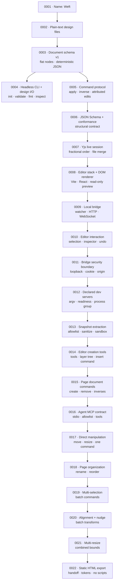

# Decision records

This directory is the project's long-form memory: **what we chose, why, what we tried before, what broke, and why we changed.**

`CHANGELOG.md` records what shipped to users. An Architecture Decision Record (ADR) records *why the product is built this way* and whether that reasoning still holds. `docs/HISTORY.md` is the timeline that ties the two together.

## Rules

- One decision per file, named `NNNN-short-title.md`. Numbers are assigned once and are never reused or renumbered.
- Status is one of `Proposed`, `Accepted`, `Rejected`, `Deprecated`, `Superseded by NNNN`.
- To change a decision, **add a new ADR** that supersedes it. Set the old record's status to `Superseded by NNNN`; never delete or rewrite it.
- Write for a reader who joins in two years: context, the decision, consequences (including the bad ones), the alternatives, and why they lost.
- When a decision is revisited, say explicitly what was wrong with the previous choice.
- Security-relevant decisions (sandboxing captured pages, agent permissions, sync transport) also update `SECURITY.md` where behaviour changes.

## Index

| ADR | Title | Status | Area |
| --- | --- | --- | --- |
| [0001](0001-project-name.md) | Project name: Weft | Accepted | Identity |
| [0002](0002-design-files-as-plain-text.md) | Design files are plain-text, agent-readable documents | Accepted | Document model |
| [0003](0003-document-schema-v1.md) | Document schema v1: flat nodes, deterministic JSON, captured pages beside the tree | Accepted | Document model |
| [0004](0004-headless-cli-and-design-io.md) | Headless CLI and design I/O before the editor | Accepted | Tooling |
| [0005](0005-command-protocol.md) | Serializable page commands with inverses for every mutation | Accepted | Contract |
| [0006](0006-published-json-schema.md) | Published JSON Schema and a conformance fixture suite | Accepted | Contract |
| [0007](0007-yjs-live-sessions.md) | Yjs live sessions with fractional order and conservative file-write merge | Accepted | Live document |
| [0008](0008-editor-stack-dom-renderer.md) | Editor stack v1: Vite + React + a DOM-first renderer | Accepted | UI / rendering |
| [0009](0009-local-bridge-live-preview.md) | Local bridge: watched files, HTTP, and Yjs over WebSocket | Accepted | Live transport |
| [0010](0010-editor-interaction.md) | Editor interaction: selection, inspector, and commands over the bridge | Accepted | UI / editing |
| [0011](0011-bridge-security-boundary.md) | Local bridge security boundary | Accepted | Security |
| [0012](0012-declared-dev-servers.md) | Declared project dev servers | Accepted | Local workspace |
| [0013](0013-snapshot-extraction.md) | Snapshot extraction | Accepted | Capture / security |
| [0014](0014-editor-create-tools.md) | Editor creation tools and layer tree | Accepted | UI / editing |
| [0015](0015-page-document-commands.md) | Page-level document commands | Accepted | Contract / document model |
| [0016](0016-agent-mcp.md) | Agent MCP contract | Accepted | Agent surface |
| [0017](0017-direct-manipulation.md) | Direct layout manipulation | Accepted | UI / editing |
| [0018](0018-page-organization.md) | Page organization | Accepted | Contract / UI |
| [0019](0019-multi-selection.md) | Multi-selection and batch commands | Accepted | Contract / UI |
| [0020](0020-alignment-and-nudge.md) | Batch alignment and keyboard nudge | Accepted | UI / editing |
| [0021](0021-multi-resize.md) | Combined multi-selection resize | Accepted | UI / editing |
| [0022](0022-static-export.md) | Static HTML export and handoff | Accepted | Export / handoff |

## Decision map

## Adding a record

1. Pick the next number and copy `template.md`.
2. Fill in context, decision, consequences, alternatives, and prior art.
3. Add a row to the index above and update the map if the decision changes relationships.
4. Add a row to `docs/HISTORY.md`.
5. If it supersedes an ADR, update that ADR's status and the `Superseded by` field.
